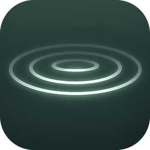

<p align="center">
  
</p>

<h1 align="center">Murmur</h1>

<p align="center">
  Dictation for macOS. Hold a key, talk, let go.<br>
  Speech recognition runs on your Mac, so there is no account and no API key.
</p>

<p align="center">
  <a href="https://github.com/georgenijo/murmur-app/releases/latest"><b>Download</b></a>
  &nbsp;·&nbsp;
  <a href="docs/FEATURES.md">Features</a>
  &nbsp;·&nbsp;
  <a href="#build-from-source">Build from source</a>
</p>

<p align="center">
  <picture>
    <source media="(prefers-color-scheme: dark)" srcset="docs/readme/demo-dark.svg">
    
  </picture>
</p>

## Install

1. Download the latest `.dmg` from [Releases](https://github.com/georgenijo/murmur-app/releases/latest).
2. Drag Murmur into Applications and open it from there. Running it straight
   from the disk image stops updates from working.
3. Follow the setup assistant. It asks for Microphone and Accessibility access,
   downloads a speech model (about 470 MB), and lets you pick a trigger key.

Murmur needs an Apple Silicon Mac on macOS 14 or later. It updates itself.

## Using it

Pick a trigger key: Left Shift, Left Option, Right Control, Fn, or any of
F1–F20. Then either hold it while you talk, or double-tap to start and tap once
to stop. You can have both. If you like, a recording started with a double-tap
ends on its own after a few seconds of silence.

The text always lands on your clipboard. Auto-paste into the app you were using
is optional. While you talk, a small overlay shows that Murmur is listening,
either in the notch or as a pill above the Dock. It never takes focus from what
you were doing.

The main window is a searchable history of your last 200 dictations. You can
also drop a WAV, MP3, M4A, MP4, or MOV file on it to transcribe a recording.

## What it does to your words

After the speech model, the text goes through a fixed set of rules. There is no
language model in this step, so the same words give the same result every time.

| You say | You get |
|---|---|
| port eight zero eight zero | `port 8080` |
| four thirty PM | `4:30 PM` |
| September seventeenth twenty twenty six | `September 17, 2026` |
| version two point seventeen point two | `version 2.17.2` |
| cargo test dash dash dash test threads equals one | `cargo test -- --test-threads=1` |
| npx create vite at latest my app dash dash template react typescript | `npx create-vite@latest my-app --template react-ts` |

The last two only happen where you would type a command, such as a terminal.
Filler words like "um" are dropped, and "new paragraph" or "scratch that" do
what you would expect.

You can also teach it:

- **Vocabulary.** Names, jargon, and identifiers scanned from a project folder.
- **Aliases.** If it keeps hearing "Tori", tell it you mean "Tauri".
- **Snippets.** Say a short phrase, get a longer block of text.
- **Per-app styles.** Polished prose in Mail, literal text in a terminal.
- **Corrections.** Fix a transcript and Murmur offers to remember that one fix.

All of this is stored locally and can be inspected, exported, or deleted in
Settings.

## Meetings

The Notetaker records a call on two channels, your microphone as "Me" and the
Mac's audio as "Them", and transcribes while the meeting is running. Sessions
are searchable, and you can export them as text or as SRT/WebVTT captions.
This needs macOS 14.2 or later. See [Meeting Capture](docs/features/meeting-capture.md).

## Models

Models download on demand and can be switched in Settings.

| Model | Runs on | Size | Language |
|---|---|---:|---|
| Parakeet TDT 0.6B v3 (default) | Apple Neural Engine | ~470 MB | Multilingual |
| Parakeet TDT 0.6B v2 | CPU | ~1.2 GB | English |
| Whisper Tiny | Metal GPU | ~75 MB | English |
| Whisper Base | Metal GPU | ~150 MB | English |
| Whisper Small | Metal GPU | ~500 MB | English |
| Whisper Medium | Metal GPU | ~1.5 GB | English |
| Whisper Large v3 Turbo | Metal GPU | ~3 GB | Multilingual |

The model starts loading when you press the key, so it is usually ready by the
time you finish talking. If you want to know which one is best on your machine,
the Performance Lab in Settings benchmarks the ones you have installed.

## Privacy

Your audio and your text never leave your Mac. Transcription, cleanup, history,
vocabulary, and meeting transcripts are all local. Recordings are kept on disk
only if you ask for that.

Murmur does use the network for three things:

- Downloading models, from pinned sources.
- Checking for and downloading signed app updates.
- Diagnostics. Release builds upload events for support: timings, states, error
  codes, a random install ID, the computer name, the macOS version, and basic
  hardware facts. They never include audio, transcripts, clipboard contents, or
  project paths. To turn this off, launch Murmur with `MURMUR_LOG_SHIPPER=off` in
  its environment.

The exact contract is in [log shipping](docs/features/log-shipping.md).

## How it works

<picture>
  <source media="(prefers-color-scheme: dark)" srcset="docs/readme/pipeline-dark.svg">
  
</picture>

Murmur is a Tauri app: Rust for the native side, React for the windows. The
microphone is owned by a small signed helper process, so if Core Audio hangs,
Murmur can kill the helper and carry on. Every recording gets a generation
number, and late results from an older recording are discarded instead of
overwriting a newer one.

The [architecture guide](docs/ARCHITECTURE.md) has the full picture.

## Build from source

You need an Apple Silicon Mac on macOS 14 or later, the Xcode Command Line
Tools, [CMake](https://cmake.org/), [Node.js](https://nodejs.org/) 18+,
[Rust](https://rustup.rs/) stable, and Python 3.

```bash
git clone https://github.com/georgenijo/murmur-app.git
cd murmur-app

# Build the capture helpers first. A fresh clone will not compile without them.
python3 scripts/build_capture_helpers.py

cd app
npm ci
npm run tauri:dev
```

`npm run tauri:build` produces the app and a DMG. To run the tests:

```bash
cd app
npx tsc --noEmit
npm test

cd src-tauri
cargo test -- --test-threads=1
```

[Development](docs/DEVELOPMENT.md) covers permissions, the remaining test
suites, release builds, and troubleshooting.

## More

[Features](docs/FEATURES.md) ·
[Architecture](docs/ARCHITECTURE.md) ·
[Development](docs/DEVELOPMENT.md) ·
[First run](docs/onboarding.md) ·
[Commands and events](docs/reference/) ·
[Decisions](docs/decisions/DECISIONS.md) ·
[Changelog](CHANGELOG.md) ·
[Releases](docs/release.md)

MIT licensed. See [LICENSE](LICENSE) and
[THIRD_PARTY_NOTICES.md](THIRD_PARTY_NOTICES.md).
